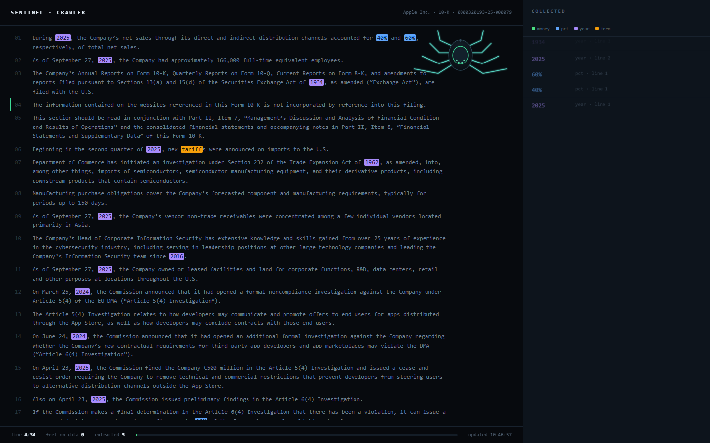
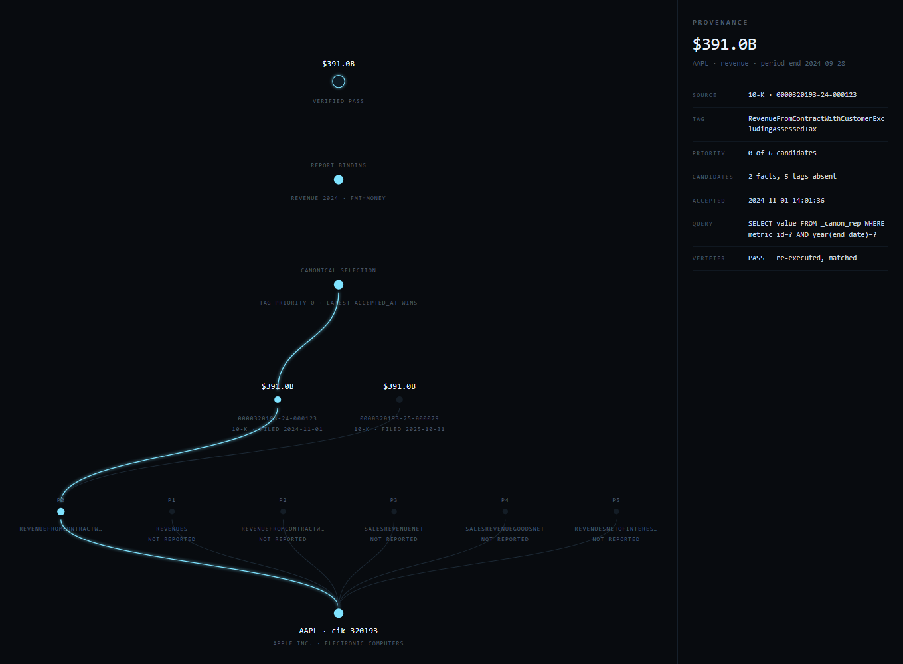

# SENTINEL

A point-in-time research engine for US-listed companies. It crawls public SEC data,
keeps every fact with its provenance, and writes reports whose numbers a machine can
re-derive and confirm.

The product is not a dashboard and not a price predictor. It is **findings with
provenance**: every figure traceable to an accession number, every claim re-runnable.

*Top: [`viz/crawler.html`](viz/crawler.html) — a spider whose legs reach the spans it extracts
from Apple's FY2025 10-K; the text and 49 highlights are parsed from the filing, not typed.*

*Second: [`viz/provenance.html`](viz/provenance.html) — the real decision path behind one
reported figure: six candidate tags, five never reported, two accessions carrying the same
$391.0B, and the verification result.*

---

## Status

| Phase | State | Evidence |
|---|---|---|
| 0 — Reconnaissance | done | 9 SEC endpoints probed, [source registry](docs/SOURCE_REGISTRY.md) |
| 1 — Vertical slice | done | dossier with 71 bound figures, all re-verified |
| 2 — Universe and backfill | done | 707 companies, 759 closed index intervals retained |
| 3 — Dictionary and golden set | done | 64 metrics, 1,684 values reconciled against SEC, **100.0%** |
| 4 — Analytics | partial | peer precision@10 **0.789**; quality scores; importance **blocked on prices** |
| 6 — The watch | done | daily-index change detection, 1,125 events, quiet-by-default digest |
| 5, 7 — Forecast, reports, dashboard | not started | blocked on price data / not built |

Current warehouse: **4.59M XBRL facts**, **515k filings**, **1.87M canonical rows**.

## Quickstart (Windows)

    py -3.11 -m venv .venv
    .\.venv\Scripts\python.exe -m pip install -e .
    Copy-Item .env.example .env      # put your email in SENTINEL_CONTACT_EMAIL

    .\.venv\Scripts\sentinel.exe init
    .\.venv\Scripts\sentinel.exe universe
    .\.venv\Scripts\sentinel.exe backfill --limit 50
    .\.venv\Scripts\sentinel.exe report dossier --ticker AAPL
    .\.venv\Scripts\sentinel.exe verify reports\out\<date>\<date>_dossier_AAPL.md

The visualisations need a server (`file://` blocks the data fetch):

    python scripts/serve_viz.py 8777
    # http://127.0.0.1:8777/crawler.html     spider reading a filing, auto-updating
    # http://127.0.0.1:8777/provenance.html  decision path for one reported number

Then, depending on what you want:

    sentinel watch --days 3                      # what changed, and only if it matters
    sentinel peers --ticker KO --k 10            # nearest companies by fingerprint
    sentinel quality --ticker AAPL               # Piotroski, Altman, accruals
    sentinel dq                                  # data-quality monitors
    sentinel restatements --limit 10             # values that changed between filings
    sentinel coverage                            # what the warehouse actually holds
    sentinel golden --n 25                       # reconcile against SEC's own endpoint
    sentinel reparse                             # re-parse cache after a dictionary change

The SEC requires a declared contact address in the User-Agent. Set
`SENTINEL_CONTACT_EMAIL` before the first fetch.

## What it can do

- Ingest any US-listed filer by CIK or ticker, with point-in-time canonical metrics from
  an ordered XBRL tag chain and every revision retained.
- Build the S&P 500 universe **with its history**: 1,262 membership intervals, 759 of
  them closed, so dead and demoted companies stay in the data.
- Produce a company dossier in which every number is bound to a SQL query, then verify
  it and fail if a figure no longer reproduces.
- Detect what changed via the SEC daily index, score materiality, and stay silent when
  nothing did.
- Reconcile its own numbers against SEC's independently-served concept endpoint.

## What it cannot do

- **No prices.** Stooq serves a JavaScript challenge and Yahoo returns 429 from this
  machine. Without returns there is no correlation, no importance ranking, no event study
  and no forecast. Nothing was substituted for them.
- **No filing text in the warehouse.** Text extraction is Phase 3b; the visualisation
  parses one document directly.
- **8-Ks score by form, not by item.** A results release and a non-reliance notice weigh
  the same today.
- 658 index tickers never resolved to a CIK (renamed or dead) and are excluded.

The full list is in [docs/LIMITATIONS.md](docs/LIMITATIONS.md). It is kept current and
it is not flattering.

## How it is built

    source -> raw bytes (SHA-256, immutable) -> parse -> warehouse -> canonical (as-of)
           -> bindings -> report -> verifier -> PASS/FAIL

Five structural commitments: the raw layer is immutable and content-addressed; revisions
are never overwritten; canonical metrics are selected at query time against an as-of
timestamp; reports cannot print a number without a query behind it; and the verifier is
a build gate, not a lint.

## Data and licensing

Code is MIT. Data is not redistributed. SEC EDGAR data is public domain under the SEC's
fair-access policy; FRED, Ken French, index providers and the S&P 500 membership dataset
have their own terms, recorded in [docs/SOURCE_REGISTRY.md](docs/SOURCE_REGISTRY.md).

## Disclaimer

Research output generated from public data. Not investment advice. Numbers are as of the
stated retrieval date and may since have been restated.
